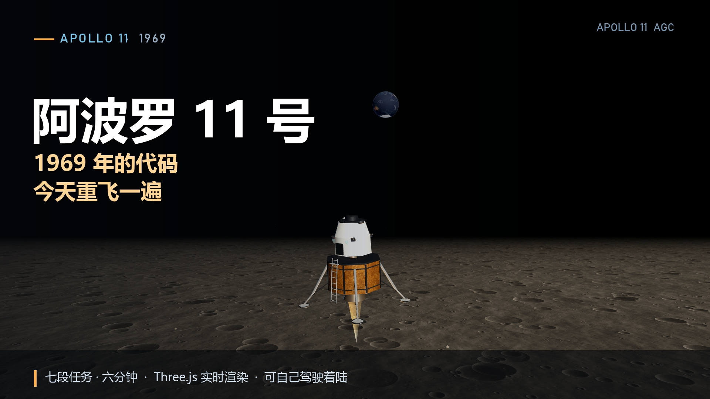

# 阿波罗 11 号 · AGC 任务控制台

一个纯前端的阿波罗 11 号全流程 3D 模拟器。打开 `index.html` 就能跑，不用装环境、不用连网。

七段任务 + 三段可交互模式：土星五号发射、地月转移、环月轨道、动力下降、月面出舱、上升返回、再入溅落，另外可以自己手动驾驶登月舱着陆、拉中止逃逸、开月球车在月面漫游。

在线玩：
- GitHub Pages：<https://sqdcz.github.io/apollo11-agc/>
- B 站玩具平台：<https://www.bilibili.com/toy/apollo11-agc/index.html>（审核中）



## 跑起来

贴图是独立文件，`file://` 打开会被浏览器的 CORS 拦掉，得起个本地服务：

```bash
python -m http.server 8000
# 然后打开 http://127.0.0.1:8000/index.html
```

用 `npx serve`、VS Code 的 Live Server 也一样。

## 操作

| 动作 | 键盘 | 触屏 |
|---|---|---|
| 手动下降 / 漫游 | 方向键 | 右下角方向键 |
| 开始 / 暂停 | 空格 | 面板按钮 |
| 切章节 | 左右方向键 | 时间线点击 |
| 切换机位 | C | 面板按钮 |

七个章节在底部时间线上，可以随便跳。右侧遥测面板的高度、速度、燃料、俯仰角都是实时算的，不是写死的数字。

## 双尺度渲染

这是整个项目里最麻烦的一件事。

深空段用 **1 单位 = 1 公里**（地球半径 6371 单位），月面段用 **1 单位 = 1 米**（登月舱 4.45 单位高）。两个尺度差 1000 倍，塞不进同一个场景，所以每章切换时会重建机位、重新设裁剪面（`camera.near/far`），再配合 `logarithmicDepthBuffer` 压住深度精度。

好处是月面段可以做真正的米级细节（下降发动机扬尘、月球车辙印），深空段又能把地月距离 38 万公里画准。

代价是单位混淆——本项目一半的 bug 都是同一个原因是：米制章节里写了 `engineLight.distance = 0.06`（那是 6 厘米，灯根本照不亮东西），或者把登月舱上升级的**局部高度**当成**世界高度**喂给相机（镜头对着半空，整段黑屏）。代码里所有这类地方都写了注释标单位。

## 动力下降的制导

降落不是播动画，是真的按物理积分走的：

```js
// 可用推力加速度约 5.1 m/s²，扣掉月面重力 1.62，净减速空间只有 3.5
if (D.landed) return 0;
var tgt = D.alt > 3000 ? -55 : D.alt > 500 ? -35 : D.alt > 160 ? -10 : -1.5;
```

一开始末段目标速度设成 −2.2、到 100 米才切换，结果根本刹不住——实测触月 −24 m/s，日志老老实实打印"着陆失败"。改成 500 米转 −10、160 米转 −1.5 之后，触月是 −1.5 m/s。

另外注意 `CH[3].update(dt)` 内部又乘了一次速度倍率，所以每帧推进的仿真时间是 `dt × speed²`，不是线性的。要按帧数反解时长，得开平方。

## 声音与字幕

没有声音。要看带解说的版本，去 B 站。

## 素材

- 地球：`earth_atmos_2048.jpg` / `earth_normal_2048.jpg` / `earth_specular_2048.jpg` / `earth_lights_2048.png` / `earth_clouds_1024.png`
- 月球：`moon_1024.jpg`
- 渲染库：three.js r128（`three.min.js`，本地文件，不走 CDN）

## 目录

```
index.html              页面骨架 + HUD + 样式
apollo11_app.js         全部 3D 与物理逻辑（约 2600 行）
three.min.js            three.js r128
*.jpg / *.png           星球贴图
docs/                   封面、Toy 海报、B 站投稿文案
```
